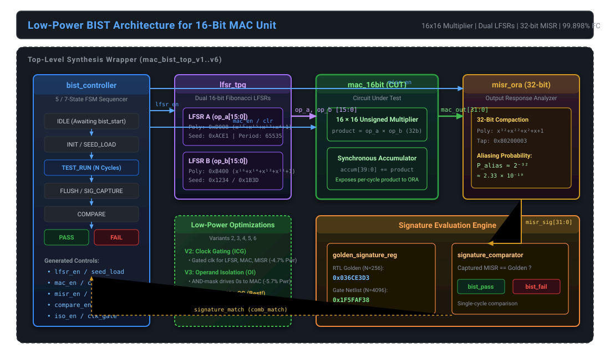
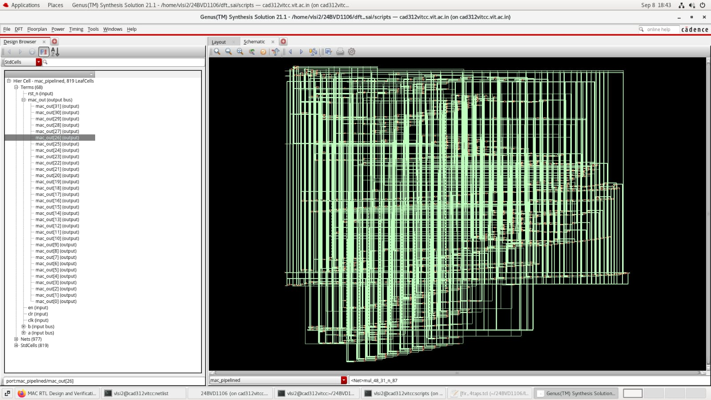
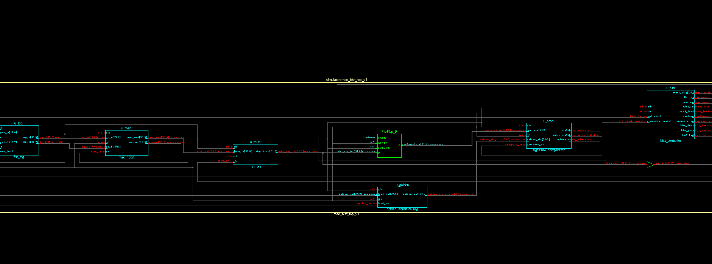
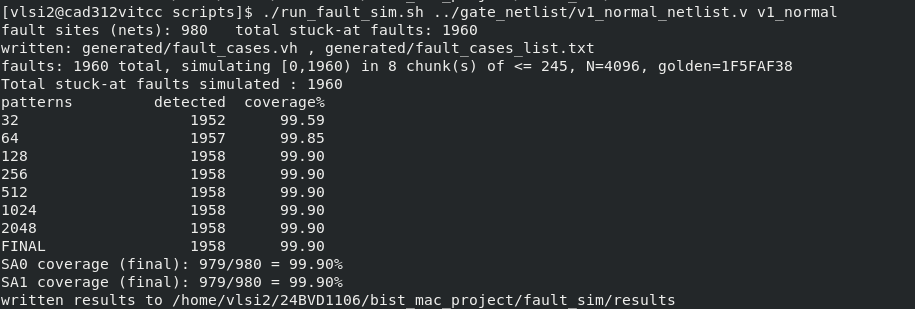
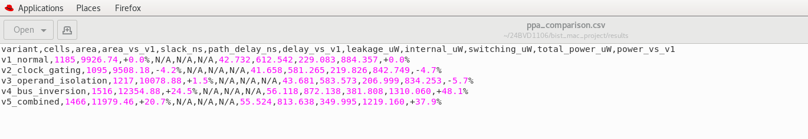

# Low-Power MAC BIST: PPA and Fault Coverage Analysis

**A comparative study of BIST-enabled 16-bit MAC architectures, investigating fault detection effectiveness, test overhead, and hardware PPA, with an emphasis on low-power design considerations.**

[](rtl/)
[](synthesis/)
[](verification/)
[](results/)
[](LICENSE)

---

## 1. Project Overview

Multiply-Accumulate (MAC) units are critical arithmetic blocks in digital signal processors (DSPs) and machine learning accelerators. Embedded deep within modern System-on-Chip (SoC) architectures, direct pin access by external Automatic Test Equipment (ATE) is infeasible. Built-In Self-Test (BIST) addresses this by incorporating pattern generation and response compaction directly on-chip.

However, pseudo-random testing introduces excessive switching activity (often 2× to 4× higher than mission mode), resulting in elevated IR drop, thermal stress, and potential yield loss during test. 

This repository presents a complete, silicon-oriented evaluation of **six synthesizable 16-bit MAC BIST architectures** (IEEE 1364-2001 Verilog) synthesized under a 100 MHz constraint in **Cadence Genus 21.1** and verified via gate-level stuck-at fault injection across 1960 faults in **Cadence Incisive**.

---

## 2. Engineering Problem & Objectives

1. **At-Speed In-System Testability**: Eliminate reliance on expensive high-pin-count ATE by integrating on-chip stimulus generation and signature compaction.
2. **High Defect Detection**: Achieve $>99.8\%$ single stuck-at fault coverage on the arithmetic core with negligible aliasing probability ($P_{\text{alias}} \approx 2^{-32}$).
3. **Test Power Mitigation**: Evaluate architectural low-power techniques—**Integrated Clock Gating (ICG)**, **Operand Isolation (OI)**, and **Bus Inversion (BI)**—to minimize test dissipation without sacrificing test quality.
4. **Empirical PPA Characterization**: Synthesize all variants under identical constraints to measure cell count, area, leakage, internal, and switching power.

---

## 3. Architecture Specification

The system comprises five core modules:

* **Circuit Under Test (CUT)** ([`mac_16bit.v`](rtl/common/mac_16bit.v)): A 16×16 unsigned multiplier feeding a 40-bit accumulator (32-bit product + 8 guard bits). The 32-bit per-cycle multiplier product (`mac_out`) is exposed directly to the ORA to prevent early arithmetic fault masking.
* **Test Pattern Generator (TPG)** ([`lfsr_tpg.v`](rtl/common/lfsr_tpg.v)): Dual independent 16-bit Fibonacci LFSRs with primitive polynomials ($P_A: \text{0xD008}$, $P_B: \text{0xB400}$) providing uncorrelated stimulus with a maximal period of $65,535$ states.
* **Output Response Analyzer (ORA)** ([`misr_ora.v`](rtl/common/misr_ora.v)): 32-bit Galois MISR with primitive polynomial $x^{32} + x^{22} + x^2 + x + 1$ (Tap: `0x80200003` / `0x00400007`), offering an aliasing probability of $2^{-32} \approx 2.33 \times 10^{-10}$.
* **BIST Controller FSM** ([`bist_controller.v`](rtl/common/bist_controller.v)): One-hot state sequencer governing `IDLE` $\rightarrow$ `INIT` $\rightarrow$ `TEST_RUN` ($N$ cycles) $\rightarrow$ `FLUSH` $\rightarrow$ `COMPARE` $\rightarrow$ `PASS`/`FAIL`.
* **Golden Signature Register & Comparator** ([`golden_signature_reg.v`](rtl/common/golden_signature_reg.v), [`signature_comparator.v`](rtl/common/signature_comparator.v)): Local reference storage and registered comparison logic.

### Architectural Block Diagram



---

## 4. Architectural Variants

| Variant | Top Module | Low-Power Mechanism | Primary Benefit / Finding |
|:---:|:---|:---|:---|
| **V1** | [`mac_bist_top_v1.v`](rtl/baseline/mac_bist_top_v1.v) | Baseline Reference | Reference baseline for all PPA comparisons |
| **V2** | [`mac_bist_top_v2.v`](rtl/low_power/clock_gating/mac_bist_top_v2.v) | Integrated Clock Gating (ICG) | **-4.7% Total Power**, **-4.2% Area** via glitch-free clock gating |
| **V3** | [`mac_bist_top_v3.v`](rtl/low_power/operand_isolation/mac_bist_top_v3.v) | Operand Isolation (OI) | **-5.7% Total Power**, **-9.6% Switching Power** via AND-gating |
| **V4** | [`mac_bist_top_v4.v`](rtl/low_power/bus_inversion/mac_bist_top_v4.v) | Bus Inversion (BI) | **+48.1% Total Power** (Negative result: encoder overhead > savings) |
| **V5** | [`mac_bist_top_v5.v`](rtl/low_power/combined_all/mac_bist_top_v5.v) | Combined All (CG + OI + BI) | **+37.9% Total Power** (Dominated by bus inversion logic) |
| **V6** | [`mac_bist_top_v6.v`](rtl/low_power/combined_oi_cg/mac_bist_top_v6.v) | **Combined (OI + CG)** | **-10.1% Total Power**, **-2.7% Area** (**Optimal Configuration**) |

---

## 5. Synthesis & Measured PPA Results

All variants were synthesized in **Cadence Genus 21.1** targeting a commercial standard-cell library (`slow_vdd1v0.lib`, 1.0 V supply, slow corner) under a 100 MHz clock period (10.0 ns period, 0.10 ns uncertainty).

### Post-Synthesis PPA Benchmark Table

| Variant | Architecture | Cell Count | $\Delta$ Cells | Area ($\mu\text{m}^2$) | $\Delta$ Area | Leakage ($\mu\text{W}$) | Internal ($\mu\text{W}$) | Switching ($\mu\text{W}$) | Total Power ($\mu\text{W}$) | $\Delta$ Total Power |
|:---:|:---|:---:|:---:|:---:|:---:|:---:|:---:|:---:|:---:|:---:|
| **V1** | Baseline | 1185 | 0.0% | 9926.74 | 0.0% | 42.732 | 612.542 | 229.083 | 884.357 | 0.0% |
| **V2** | Clock Gating | 1095 | -7.6% | 9508.18 | -4.2% | 41.658 | 581.265 | 219.826 | 842.749 | **-4.7%** |
| **V3** | Operand Isolation | 1217 | +2.7% | 10078.88 | +1.5% | 43.681 | 583.573 | 206.999 | 834.253 | **-5.7%** |
| **V4** | Bus Inversion* | 1516 | +27.9% | 12354.88 | +24.5% | 56.118 | 872.138 | 381.808 | 1310.060 | +48.1%* |
| **V5** | Combined All* | 1466 | +23.7% | 11979.46 | +20.7% | 55.524 | 813.638 | 349.995 | 1219.160 | +37.9%* |
| **V6** | **Combined OI + CG** | **1127** | **-4.9%** | **9660.32** | **-2.7%** | **42.583** | **553.775** | **198.634** | **794.993** | **-10.1%** |

*\*Note: Raw metrics exported from Genus reports; verified against [`results/ppa_comparison.csv`](results/ppa_comparison.csv).*

### Key PPA Findings:
1. **Optimal Configuration (V6)**: Combining Operand Isolation with Clock Gating yielded the lowest total power consumption ($794.993\ \mu\text{W}$, a **10.1% overall reduction**), accompanied by a **13.3% reduction in dynamic switching power** and a **2.7% reduction in silicon area**.
2. **Negative Result Transparency (V4)**: Bus inversion increased power by +48.1%. Because on-chip wire capacitance is low within localized BIST modules, the dynamic power of the 16-bit transition-counting and re-inversion logic significantly exceeded the bus savings.

---

## 6. Fault Simulation & Test Coverage

Fault grading was executed on the Cadence Genus post-synthesis gate-level netlist of the baseline MAC core (`v1_normal_netlist.v`) using **Cadence Incisive**.

* **Target Fault Model**: Single Stuck-At (SSA) across all internal net sites (excluding `clk` and `rst_n`).
* **Fault Sites**: 980 net sites $\times$ 2 polarities (SA0 & SA1) = **1960 total modeled faults**.
* **Test Length**: 4096 pseudo-random patterns.
* **Golden Signature**: `0x1F5FAF38` (Gate-level netlist) / `0x036ce3d3` (RTL 256-cycle behavioral).

### Fault Coverage Progression

| Pattern Count ($N$) | Detected Faults | Total Faults | Fault Coverage (%) | Status |
|:---:|:---:|:---:|:---:|:---:|
| **32** | 1952 | 1960 | 99.5918% | Fast initial steep ramp |
| **64** | 1957 | 1960 | 99.8469% | Excites deep logic |
| **128** | 1958 | 1960 | **99.8980%** | Reaches asymptotic plateau |
| **256 – 4096** | 1958 | 1960 | **99.8980%** | Stable coverage |

### Root-Cause Analysis of Undetected Faults:
Exactly 2 out of 1960 faults escaped detection:
1. `fault_id = 1`: **Stuck-At-1 on MAC accumulate enable (`en`)**. The BIST controller holds `mac_en` continuously asserted during the entire `TEST_RUN` phase; thus, a stuck-at-1 fault produces output identical to the fault-free circuit.
2. `fault_id = 2`: **Stuck-At-0 on MAC synchronous clear (`clr`)**. The asynchronous reset initializes the accumulator to zero before BIST execution; hence, the synchronous clear asserted during `INIT` acts on an already-zero accumulator, creating no observable signature deviation.

*Detailed analysis in [`docs/methodology/FAULT_INJECTION_METHODOLOGY.md`](docs/methodology/FAULT_INJECTION_METHODOLOGY.md).*

---

## 7. Silicon Schematics & Evidence

| Cadence Genus 21.1 Mapped Netlist | SimVision Full BIST Architectural Schematic |
|:---:|:---:|
|  |  |
| *819 leaf cells, 977 nets synthesized in Cadence Genus* | *Full RTL schematic showing TPG, MAC, MISR, and Comparator* |

| Live Fault Simulation Terminal Execution | PPA Benchmark Raw Evidence |
|:---:|:---:|
|  |  |
| *Terminal log showing 1958/1960 faults detected (99.898%)* | *Direct capture of synthesized Genus power/area metrics* |

---

## 8. Repository Structure

```
Low-Power-MAC-BIST-PPA-Fault-Coverage/
├── README.md                           # Main repository documentation
├── LICENSE                             # MIT License
├── .gitignore                          # Standard EDA ignore list
│
├── docs/                               # Engineering documentation & paper
│   ├── project_report.pdf              # Full research paper
│   ├── LINKEDIN_POST.md                # LinkedIn presentation & portfolio guide
│   ├── architecture/
│   │   └── ARCHITECTURE.md             # Detailed block & register specs
│   └── methodology/
│       ├── FAULT_INJECTION_METHODOLOGY.md # 1960-fault gate simulation details
│       └── LOW_POWER_TECHNIQUES.md     # PPA and low-power circuit analysis
│
├── rtl/                                # 100% Verilog-2001 synthesizable source
│   ├── common/                         # Shared sub-blocks (LFSR, MAC, MISR, FSM)
│   ├── baseline/                       # Variant 1 (mac_bist_top_v1.v)
│   └── low_power/                      # Variants 2 through 6
│       ├── clock_gating/               # ICG cell & Variant 2 top
│       ├── operand_isolation/          # AND-mask cell & Variant 3 top
│       ├── bus_inversion/              # Bus encoder/decoder & Variant 4 top
│       ├── combined_all/               # Variant 5 top
│       └── combined_oi_cg/             # Variant 6 top (-10.1% power)
│
├── verification/                       # Testbenches & simulation automation
│   ├── testbench/                      # tb_mac_bist_v1.v to tb_mac_bist_v6.v
│   ├── simulation/                     # compile_all.tcl, run_sim.tcl, transcripts
│   └── fault_injection/                # run_fault_sim.tcl, run_fault_sim.sh
│
├── synthesis/                          # Cadence Genus flow
│   ├── constraints/                    # mac_bist.sdc (100 MHz, 10.0 ns)
│   ├── scripts/                        # synthesis.tcl, extract_reports.tcl
│   └── reports/                        # Synthesis report directories
│
├── results/                            # Raw data CSVs and reports
│   ├── ppa_comparison.csv              # Measured PPA numbers across all 6 variants
│   ├── coverage_summary_v1_normal.csv  # 1960-fault checkpoint data
│   ├── coverage_summary_trial.csv      # Trial run data
│   ├── undetected_v1_normal.txt        # Undetected fault list
│   └── golden_signature.txt            # RTL & Netlist golden reference signatures
│
└── figures/                            # Visuals & evidence
    ├── architecture/                   # High-res SVG & PNG block diagrams
    ├── schematics/                     # Genus & SimVision schematics
    └── results/                        # Terminal logs & PPA screenshots
```

---

## 9. Quick Reproduction Guide

### Simulation (ModelSim / Questa):
```bash
cd verification/simulation
# Compile all common modules, 6 variants, and 6 testbenches
vsim -c -do "do compile_all.tcl; quit -f"

# Execute complete functional regression
vsim -c -do run_sim.tcl
```

### Fault Simulation (Cadence Incisive / Xcelium):
```bash
cd verification/fault_injection
chmod +x run_fault_sim.sh
./run_fault_sim.sh ../../synthesis/reports/netlist/mac_bist_top_v1_netlist.v v1_normal
```

### Synthesis (Cadence Genus 21.1):
```bash
cd synthesis/scripts
genus -batch -f synthesis.tcl
tclsh extract_reports.tcl
```

---

## 10. Authors & Citation

* **Allen Joe A** ([@ALLENJOE-A](https://github.com/ALLENJOE-A)) — School of Electronics Engineering (SENSE), Vellore Institute of Technology (VIT), Chennai.
* **Bonthala Saikiran** — School of Electronics Engineering (SENSE), Vellore Institute of Technology (VIT), Chennai.
* **Dr. Papanasam E** — School of Electronics Engineering (SENSE), Vellore Institute of Technology (VIT), Chennai.

If using this architecture or benchmark in your research, please refer to the complete paper:
> B. Saikiran, A. Joe A, and P. E, *"Simulation-Based Fault Coverage Analysis and Low-Power Optimization of a BIST-Enabled 16-Bit Multiply-Accumulate Unit,"* SENSE, Vellore Institute of Technology, Chennai. Available at [`docs/project_report.pdf`](docs/project_report.pdf).

---

## 11. License

This project is licensed under the [MIT License](LICENSE).
